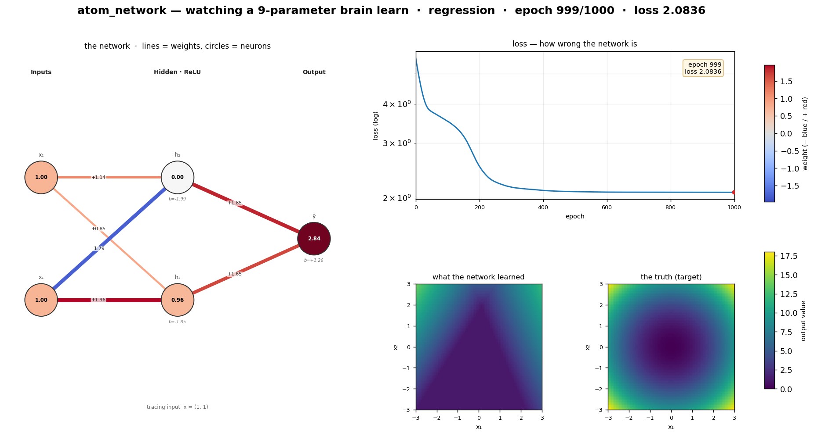
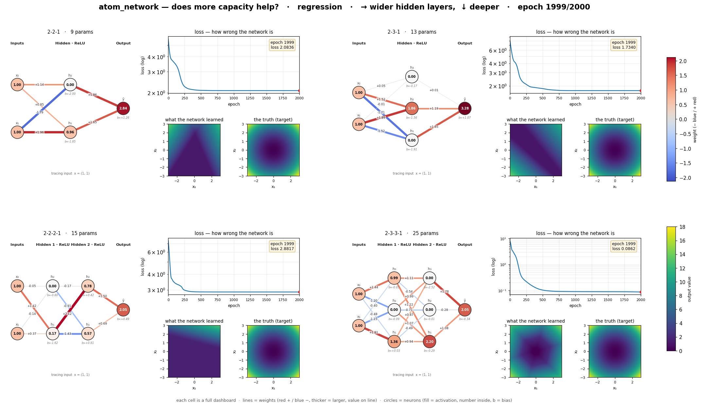

# atom_network 🔬

**A microscope for the smallest interesting neural network.**

Most neural networks are black boxes with millions of parameters. This one
has **nine**. It is small enough that you can put every weight, every neuron,
and every gradient on screen at once and *watch it learn* — frame by frame.

```
Input (2)  →  Hidden (2, ReLU)  →  Output (1)
```

That's it. Two inputs, two hidden neurons, one output. Nine numbers total
(6 weights + 3 biases). The whole project exists to make those nine numbers,
and what they do, visible to a human.

---

## What you get

Run it and you produce an animated dashboard with four synchronized panels:

| panel | what it shows |
|-------|---------------|
| **left** | the network itself — circles are neurons (coloured by their value), lines are weights (red = positive, blue = negative, thick = large). You are looking at the nine numbers being tuned in real time. |
| **top-right** | the **loss** falling as the network gets less wrong. |
| **bottom-middle** | the function the network represents **right now**. |
| **bottom-right** | the function it's **trying** to match (the ground truth). |

The story of learning is watching the bottom-middle morph into the
bottom-right, while the weights shift on the left and the loss drops on the
top-right — all at the same time.



---

## Quick start

This project uses [`uv`](https://docs.astral.sh/uv/) with a project-local
virtual environment (no global/conda install needed). PyTorch ships the CUDA
build; training **prefers the RTX 3070** automatically and falls back to CPU.
(A single tiny net is actually faster on CPU — the GPU earns its keep once the
capacity grid below grows. Force a device with `--device cpu` / `--device cuda:N`.)

```bash
uv sync                 # creates .venv and installs torch (CUDA), matplotlib, numpy

uv run python main.py                                   # regression: learn a smooth bowl
uv run python main.py --task classification --epochs 2000   # learn XOR (needs the hidden layer)
```

Outputs land in `outputs/` as both an animated `*.gif` and a final `*.png`.

### Options

```
--task {regression,classification}   what to learn        (default: regression)
--epochs N                           training epochs      (default: 1000)
--lr LR                              learning rate        (default: 0.01)
--snapshot-every N                   one frame per N epochs (default: 20)
--fps N                              gif frame rate       (default: 12)
--out DIR                            output directory     (default: outputs)
```

---

## The two tasks

- **regression** — learn `y = x₁² + x₂²`, a smooth bowl. With only two ReLU
  neurons the network can't fit it perfectly; watching *how it approximates*
  a curved surface with a few straight folds is itself the lesson.
- **classification** — learn the XOR-like rule "label 1 when x₁ and x₂ share a
  sign," a four-quadrant checkerboard. Two hidden neurons aren't quite enough
  to carve it cleanly: the network gets the dominant diagonal and stalls. That
  honest near-miss is the lesson — you are *seeing* the capacity limit of a
  9-parameter brain, not a bug.

---

## Is nine parameters enough? — the capacity grid

Short answer: no, not for the bowl. To *show* it, train a whole grid of
networks at once and watch them learn side by side:

```bash
uv run python grid.py                                   # 2x2 regression grid
uv run python grid.py --rows 3 --cols 3 --task classification
```

- **→ across columns**: each hidden layer gains one neuron (wider).
- **↓ down rows**: one more hidden layer is added (deeper).
- the input (2) and output (1) never change — they're fixed by the problem.

Every cell is a **full dashboard** — the same network diagram + loss curve +
learned-surface + truth you get for a single network — so no detail is lost;
only the colour scales are shared across the grid instead of repeated. The
2×2 regression grid makes the point bluntly — going from the corner 2-2-1
(9 params) to 2-3-3-1 (25 params) drops the loss by more than 10×:



## How it's built

```
atom/
├── model.py       SimpleMLP — the 2-2-1 network, plus .trace() and .snapshot()
│                  so it can report its own internals for drawing.
├── data.py        the two synthetic datasets + the ground-truth surface.
├── monitor.py     NetworkMonitor — PyTorch forward/backward hooks that read
│                  activations and gradients without touching the model.
├── train.py       the training loop; every few epochs it freezes a "frame".
└── visualize.py   turns the sequence of frames into the GIF + PNG dashboard.
main.py            command-line entry point.
```

The design idea: **training produces a flip-book**, and **visualization plays
it back**. The two concerns stay cleanly separated, which is why the same
recorded history can become a smooth animation or a single crisp still.
